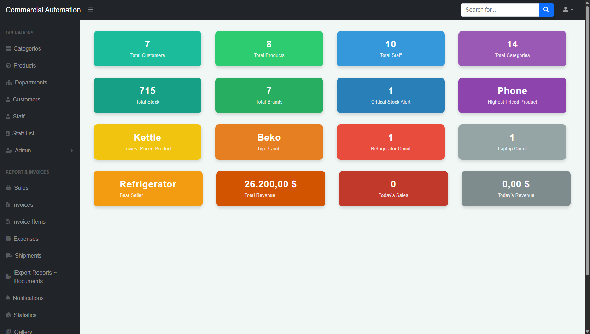
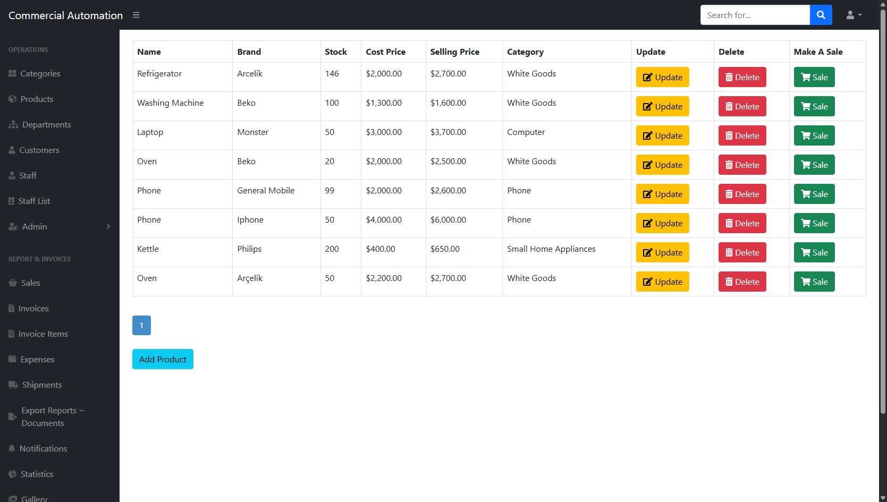
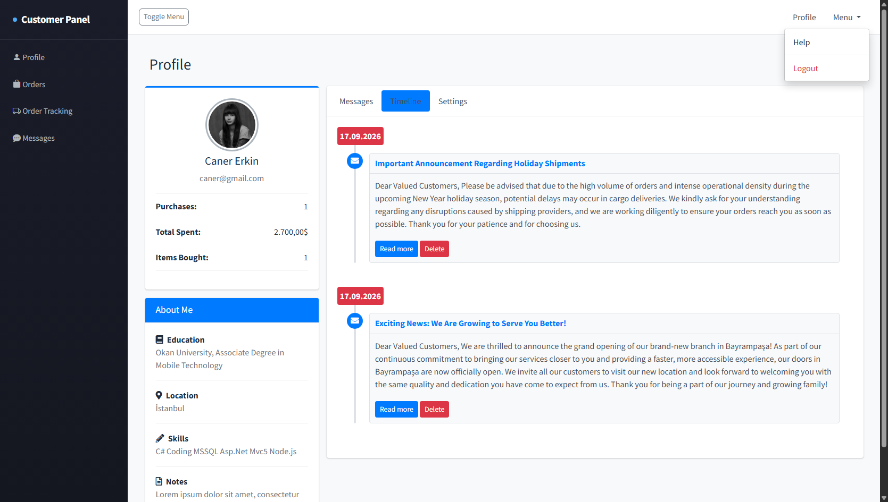

# MVC Online Commercial Automation

A web-based commercial automation system built with **ASP.NET MVC 5** and **Entity Framework 6 (Code First)**. It lets a company manage products, customers, staff, sales, invoices and shipments from an admin panel, while customers get their own panel to track orders and message the company.

> Personal learning project built to practice full-stack development with the .NET Framework stack.

## Features

### Admin Panel
- **Product management**: add, update, soft-delete (status flag) and list products with categories, stock and cost/selling prices; server-side pagination with PagedList
- **Category management**: full CRUD with pagination
- **Customer & staff management**: CRUD operations, department assignment, customer purchase history
- **Department management**: restricted to users with the admin role (`[Authorize(Roles = "A")]`) and a staff sales view per department
- **Sales tracking**: create and update sale transactions linking customer, product and staff
- **Invoicing**: create invoices with multiple line items and view invoice details
- **Shipment & cargo tracking**: create shipments with an auto-generated 10-character tracking code and track their status history
- **Statistics dashboard**: total revenue, daily sales/revenue, stock totals, low-stock alerts, best-selling product, top brand, customers per city, staff per department
- **QR code generator** (QRCoder)
- **To-do list** and a **product gallery**

### Customer Panel
- Customer registration and login (Forms Authentication)
- Dashboard with order count, total spending and total items purchased
- Order history and **order tracking by tracking code**
- **Internal messaging**: inbox, sent messages, compose and reply
- Account settings (city, password)

## Tech Stack

| Layer | Technology |
|---|---|
| Framework | ASP.NET MVC 5.2.9 (.NET Framework 4.7.2) |
| Language | C# |
| ORM | Entity Framework 6.5.1 (Code First + Migrations) |
| Database | Microsoft SQL Server (SQL Server Express) |
| Authentication | Forms Authentication + custom `RoleProvider` |
| Front end | Razor, Bootstrap 5, jQuery, DataTables, AdminLTE 3.0.4 |
| Libraries | PagedList.Mvc, QRCoder, Newtonsoft.Json |

## Database Design

The model contains 15 entities, including `Product`, `Category`, `Customer`, `Staff`, `Department`, `SaleTransaction`, `Invoice`, `InvoiceItem`, `Shipment`, `ShipmentTracking`, `Message`, `Expense`, `Todo` and `Admin`, with one-to-many relationships between them (e.g. Category → Products, Department → Staff, Customer/Product/Staff → SaleTransactions, Invoice → InvoiceItems).

## Project Structure

```
MvcOnlineTicariOtomasyon/
├── Controllers/      # 17 MVC controllers
├── Models/Class/     # Entities, DbContext, view models
├── Views/            # Razor views (admin, customer and shared layouts)
├── Roles/            # Custom RoleProvider
├── Migrations/       # EF Code First migrations
└── App_Start/        # Routing and bundle configuration
```

## Getting Started

### Prerequisites
- Visual Studio 2019 or later with the **ASP.NET and web development** workload
- SQL Server Express (or any SQL Server instance)

### Setup
1. Clone the repository
   ```bash
   git clone https://github.com/Sercansoy/online-commercial-automation.git
   ```
2. Open `MvcOnlineTicariOtomasyon.sln` in Visual Studio and restore the NuGet packages.
3. Check the connection string in `Web.config` and change it if your SQL Server instance is different:
   ```xml
   <add name="Context"
        connectionString="data source=.\SQLEXPRESS;initial catalog=DbCommercialAutomation;integrated security=True;"
        providerName="System.Data.SqlClient" />
   ```
4. Create the database. Either run the app (Code First creates it on first launch) or open the Package Manager Console and run:
   ```
   Update-Database
   ```
5. Add an admin user, since there is no seed data. Insert a row into the `Admins` table with a `UserName`, `Password` and `Role = 'A'`.
6. Press **F5** to run.

## Screenshots

<!-- Add 3-4 screenshots here: statistics dashboard, product list, customer panel, shipment tracking -->
| Statistics Dashboard | Product Management | Customer Panel |
|---|---|---|
|  |  |  |

## Roadmap

- [ ] Hash passwords (e.g. PBKDF2/BCrypt) instead of storing them as plain text
- [ ] Decrease product stock automatically when a sale is made
- [ ] Restrict admin controllers to the admin role so logged-in customers cannot access them
- [ ] Introduce a repository/service layer to separate data access from controllers
- [ ] Add unit tests
- [ ] Migrate to ASP.NET Core

## Author

Sercan Soy
[LinkedIn](https://www.linkedin.com/in/sercan-soy-16a5603b3 ) · [GitHub](https://github.com/Sercansoy)
